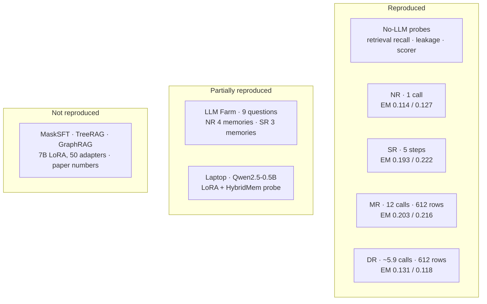

# mpr-study

Private study repo for the paper "Explicit v.s. Implicit Memory: Exploring Multi-hop Complex Reasoning Over
Personalized Information" (MPR, KDD '26). It holds a study guide with diagrams for a Data Mining final
presentation, plus a small, cheap reproduction of parts of the paper: retrieval behaviour of explicit memory, a dataset
leakage check, a tiny run of the authors' baselines on the Bosch LLM Farm, Colab T4 runs of Qwen2.5-7B-Instruct (AWQ)
covering all four reasoning structures (NR, SR, MR, DR), and a toy LoRA / HybridMem run on a laptop. All six planned
reproduction sessions (S1-S6) are complete and audited. The goal is to understand the paper's ideas, not to match its tables.

## Start here

1. Read the paper (arXiv v1): `papers/2508.13250v1.pdf`.
2. Open `docs/index.html` (the study guide: paper in 60 seconds, glossary, 4 flow charts, quizzes, talk plan, and section 10 "Verification against the paper": claim-by-claim verdicts).
3. Open [`docs/independent-reproduction-report.html`](docs/independent-reproduction-report.html) for the 4-minute visual summary of all six sessions: SR and MR score above DR and NR on the frozen 306-question slice, DR is indistinguishable from one-call NR, plus the upstream bugs behind the gaps.
4. Pick an experiment below and read its folder README: the paper experiment it relates to, what we ran, a code walkthrough, a provenance table, how to run, the outcome.
5. Read `docs/reproduction-status.md` (what is reproduced, with evidence) and skim `docs/upstream-notes.md` (upstream gaps and bugs).
6. Open [`docs/mpr-experiment-map.html`](docs/mpr-experiment-map.html) for the current paper-to-experiment map, concise findings tables, and team task plan. Download/open the HTML in a browser for interactive cards and local owner fields.

## Experiments

Provenance legend: **BORROWED** = identical to the original (nuster1128/MPR at `a24953c`, cited with lines), **ADAPTED** = derived from it, **ORIGINAL TO THIS REPO** = no upstream reference.
No upstream code is copied here (the repo has no licence); every script in this repo is ADAPTED or ORIGINAL (details: [`experiments/README.md`](experiments/README.md)).

| Folder | What | Paper counterpart | Status |
|---|---|---|---|
| [`experiments/00_probes_retrieval_leak/`](experiments/00_probes_retrieval_leak/) | no-LLM retrieval recall per hop, number-leakage check | our addition (Sections 3.3.1, 4.2, 4.3) | run |
| [`experiments/01_farm_small_run/`](experiments/01_farm_small_run/) | 9-question run of the authors' `run_qa.py` on the LLM Farm | Section 4.2, Figure 3 | run, tiny |
| [`experiments/s1_t4_one_call_grid/`](experiments/s1_t4_one_call_grid/) | T4 session 1: throughput, 12-user retrieval error bars, one-call grid (900 q), leak-free rescoring | Section 4.2, Figure 3 (NR) | run |
| [`experiments/s2_t4_chain_of_thought/`](experiments/s2_t4_chain_of_thought/) | T4 session 2: 5-step chain-of-thought grid (306 q), SR vs NR | Section 4.2, Figure 3 (SR) | run |
| [`experiments/s3a_t4_topk_sweep/`](experiments/s3a_t4_topk_sweep/) | T4 session 3a: top-k sweep 10 / 20 / 30 / 50 (900 q) | Section 4.3, Figure 4 | run |
| [`experiments/s3b_t4_step_sweep/`](experiments/s3b_t4_step_sweep/) | T4 session 3b: reasoning-step sweep | Section 4.4, Figure 5 | run (3 steps best by a small margin; no detectable gain from 3 to 8 steps) |
| [`experiments/s4_laptop_lora_hybridmem/`](experiments/s4_laptop_lora_hybridmem/) | laptop session 4: small LoRA (AskSFT) and HybridMem | Sections 5 and 6, Table 3 | run, small |
| [`experiments/s5_t4_mr/`](experiments/s5_t4_mr/) | S5: MR (`StructuredReason`) multi-branch tree, BM25 and e5, 306 questions | Section 3.4.3, Figure 2; Section 4.2, Figure 3 (MR vs NR/SR) | run: 612/612 rows; EM 0.203 (BM25) / 0.216 (e5), no detectable difference from 5-step SR |
| [`experiments/s6_t4_dr/`](experiments/s6_t4_dr/) | S6: DR (`DecompositionReason`) divide/solve/merge, BM25 and e5, 306 questions | Section 3.4.3, Figure 2(d); Section 4.2, Figure 3 (DR vs NR/SR/MR) | run: 612/612 rows; EM 0.131 (BM25) / 0.118 (e5), indistinguishable from one-call NR, below SR and MR |
| [`experiments/_shared/`](experiments/_shared/) | helpers, `colab` driver `t4.sh`, T4 runbook | n/a | n/a |

Sessions 1-3b each ship a Colab notebook (`*.ipynb`, no outputs, committed unexecuted; they have not been executed as notebooks).
S5 and S6 ship Colab CLI drivers instead (`colab_mr.sh`, `colab_run.sh`) and have no notebook.

## Repository layout

| Path | Contents |
|---|---|
| [`README.md`](README.md) | This file: start here, experiments, run commands, reproduction status |
| [`setup.sh`](setup.sh) | venv via `uv`, pinned upstream clone at `a24953c`, farm patch, dataset and 9-question subset |
| [`requirements.txt`](requirements.txt) · [`env.example`](env.example) | Python dependencies; farm credentials template |
| [`experiments/`](experiments/) | One folder per experiment/session, each with its own README |
| [`experiments/_shared/`](experiments/_shared/) | `lib.py`, `grid.py`, `summarize.py`, `score.py`, `common.py`, `estimate.py`, Colab driver `t4.sh` |
| [`experiments/s5_t4_mr/`](experiments/s5_t4_mr/) · [`experiments/s6_t4_dr/`](experiments/s6_t4_dr/) | MR/DR runners, kernels, packaging, Colab drivers and local analysis tools |
| [`tests/`](tests/) | 85 local tests for the MR/DR runners, scoring and kernel staging (stdlib; a few analysis tests need numpy) |
| `upstream/` · `data/` · `results/logs/` | Gitignored: pinned clone, dataset, raw farm logs |

Committed evidence and docs:

| Path | Contents |
|---|---|
| [`results/probes/`](results/probes/) | No-LLM retrieval recall (BM25 + e5) and leakage-check write-ups |
| [`results/farm/`](results/farm/) | 9-question farm raw rows, `summary.md`, `usage.md` |
| [`results/t4/`](results/t4/) | T4 evidence: `s1`, `s2`, `s3_topk`, `s3_steps`, `s5_mr`, `s6_dr`, `sft`, `slices`, `retrieval`, `throughput`, `smoke_*`; summaries at the top level |
| [`results/laptop/`](results/laptop/) | Laptop LoRA / HybridMem rows and `sft/summary.md` |
| [`papers/`](papers/) | The paper PDF (arXiv v1) |
| [`docs/reproduction-status.md`](docs/reproduction-status.md) | Single status table with evidence and the reason for every gap |
| [`docs/index.html`](docs/index.html) | Study guide: paper in 60 seconds, glossary, diagrams, quizzes, talk plan, verification |
| [`docs/independent-reproduction-report.html`](docs/independent-reproduction-report.html) | 4-minute visual synthesis of S1-S6 |
| [`docs/mpr-experiment-map.html`](docs/mpr-experiment-map.html) | Paper-to-experiment map and team plan |
| [`docs/upstream-notes.md`](docs/upstream-notes.md) | Upstream gaps and bugs |
| [`docs/scout-report.html`](docs/scout-report.html) | Original technical scout report |
| [`docs/diagrams/`](docs/diagrams/) | Four standalone flow-chart HTMLs |
| [`docs/verification/`](docs/verification/) | Independent verification notes/script for the Table 3 hop groups |

## Run commands

Commands run from the repo root and use the `.venv` created by `setup.sh`.

### Setup and tests

```bash
./setup.sh
.venv/bin/python -m unittest discover -s tests -v
```

- `setup.sh` needs `uv` and `git`; set `TORCH_INDEX=<url>` for a GPU wheel.
- 85 tests; the parity tests read the pinned `upstream/` clone that setup creates.

### Local probes (no GPU for BM25)

```bash
.venv/bin/python experiments/00_probes_retrieval_leak/retrieval_recall.py
.venv/bin/python experiments/00_probes_retrieval_leak/leak_check.py --show-example
```

BM25 takes about 2 s; e5 takes about 40 s on a GPU plus the model download.

### Farm run (tiny, spends tokens)

```bash
cp env.example .env
for m in Ignoramus Oracle SparseRAG DenseRAG; do
  experiments/01_farm_small_run/farm_run.sh Naive "$m"
done
.venv/bin/python experiments/_shared/score.py results/farm/*/*.jsonl
```

Needs `LLM_FARM_ENDPOINT`, `LLM_FARM_KEY` and `SMALL_MODEL_NAME`; the committed runs used about 94k farm tokens.

### Colab T4: sessions 1-3b

```bash
experiments/s1_t4_one_call_grid/session1.sh
experiments/s2_t4_chain_of_thought/session2.sh
experiments/s3a_t4_topk_sweep/session3a.sh
experiments/s3b_t4_step_sweep/session3b.sh
experiments/_shared/t4.sh down
```

Needs the `colab` CLI and `data/mpr_dataset.zip`; the shared driver and VM details are in [`experiments/_shared/README.md`](experiments/_shared/README.md).
Always finish with `t4.sh down`. Regenerate a committed summary after a rerun with:

```bash
.venv/bin/python experiments/_shared/summarize.py grid --tag s1 --slice results/t4/slices/s900.json
```

### Colab T4: sessions 5-6 (MR / DR)

```bash
experiments/s5_t4_mr/colab_mr.sh results/t4/s5_mr/_colab_out
experiments/s6_t4_dr/colab_run.sh
```

One session each. The drivers hold the shared GPU lock and stop the session when done.
Validate, score and compare commands are in the folder READMEs:
[`experiments/s5_t4_mr/README.md`](experiments/s5_t4_mr/README.md) and [`experiments/s6_t4_dr/README.md`](experiments/s6_t4_dr/README.md).

### Laptop LoRA / HybridMem (session 4)

```bash
export T4_ROOT=$PWD
export MPR_QA_DIR=$PWD/data/unz/mpr_dataset/question_answer
export LAPTOP_SFT_WORK=$(mktemp -d)
.venv/bin/python experiments/s4_laptop_lora_hybridmem/laptop_farm_pairs.py
.venv/bin/python experiments/s4_laptop_lora_hybridmem/laptop_sft.py
```

Needs a CUDA GPU with about 6 GB and farm credentials; this spends about 89k farm tokens.
If the venv has a CPU-only torch wheel, rerun setup with `TORCH_INDEX=https://download.pytorch.org/whl/cu118 ./setup.sh`.
The T4 variant `session4.sh` had only a smoke run; see [`experiments/s4_laptop_lora_hybridmem/README.md`](experiments/s4_laptop_lora_hybridmem/README.md).

### Notebooks

Sessions 1-3b also ship Colab notebooks (no outputs, committed unexecuted; they have not been run as notebooks):
[`s1_t4_one_call_grid.ipynb`](experiments/s1_t4_one_call_grid/s1_t4_one_call_grid.ipynb),
[`s2_t4_chain_of_thought.ipynb`](experiments/s2_t4_chain_of_thought/s2_t4_chain_of_thought.ipynb),
[`s3a_t4_topk_sweep.ipynb`](experiments/s3a_t4_topk_sweep/s3a_t4_topk_sweep.ipynb),
[`s3b_t4_step_sweep.ipynb`](experiments/s3b_t4_step_sweep/s3b_t4_step_sweep.ipynb).
The repo is private: add a Colab secret `GITHUB_TOKEN` (read-only) for the clone cell.
Behind a corporate proxy set `REQUESTS_CA_BUNDLE=/etc/ssl/certs/ca-certificates.crt`.

## What is reproduced, and what is not

Full claim-by-claim evidence, including every gap and its reason: [`docs/reproduction-status.md`](docs/reproduction-status.md).

### Coverage



Diagram EM labels are BM25 / e5 on the frozen 306-question slice.

### T4 reasoning: same 306 questions

| Method | Session | Calls/question | BM25 EM | e5 EM | Paired Δ vs NR (BM25 / e5) | Reading |
|---|---|---:|---:|---:|---|---|
| NR, one call | S1 | 1 | 0.114 | 0.127 | baseline | baseline |
| SR, five steps | S2 | 5 | 0.193 | 0.222 | +0.078 / +0.095 | above NR |
| MR | S5 | 12 | 0.203 | 0.216 | +0.088 / +0.088 | above NR; no detectable difference from SR |
| DR | S6 | ~5.9 | 0.131 | 0.118 | +0.016 / -0.010 | no detectable difference from NR; below SR and MR |

NR is the 306-question matched subset of the 900-question S1 grid; SR, MR and DR each use the 306-question slice per retriever. Deltas are 95% paired bootstraps over questions; one slice and one seed.

**Other paired deltas:** MR - SR +0.010 (BM25) / -0.007 (e5), both include 0; DR - SR -0.062 / -0.105; DR - MR -0.072 / -0.098. On the 140 leak-free questions, MR scores 0.186 / 0.236 and DR 0.143 / 0.129.

Takeaway: SR and MR score above DR and NR on this slice, so the paper's SR >> DR ordering holds; DR's small edge over NR does not reproduce.

### Other runs

| Area | What ran | Scale | Headline result | Status |
|---|---|---|---|---|
| Retrieval probes | BM25 + e5 recall per hop; leakage check | user 0, all 12 users | Recall@20 0.488 / 0.498 over all users; hop 10 0.340 / 0.284; 53% of questions restate a number | reproduced |
| Scorer | our EM + lenient contains | all runs | upstream has no scorer; numbers are comparable only within this repo | reproduced (our code) |
| LLM Farm | NR, 4 memories; SR, 3 memories | 9 questions | NR EM: Ignoramus 0.11, Oracle 0.89, SparseRAG 0.78, DenseRAG 0.67 | partially |
| Top-k sweep (S3a) | NR, k = 10 / 20 / 30 / 50 | 900 questions | EM flat across k (BM25 0.110-0.123, e5 0.108-0.117) while recall@k rises | run; paper claim not supported |
| Step sweep (S3b) | SR, 2 / 3 / 5 / 8 steps | 306 questions | every chain beats one call; 3 steps nominally best; no detectable gain from 3 to 8 | run; partial support |
| Laptop LoRA / HybridMem (S4) | Qwen2.5-0.5B, single LoRA + HybridMem | 300 facts; 60 seen + 60 paraphrased | small probe: single LoRA closed-book contains 6/60 and 7/60, but HybridMem did not beat single LoRA with retrieval | partially |

The farm run is tiny (n = 9, one question is 0.11): only the large gaps mean anything.

### Not reproduced

| Item | Why |
|---|---|
| MaskSFT | needs LoRA training; not run |
| TreeRAG, GraphRAG | LLM index build over about 13.1k facts per user; thousands of calls, never measured |
| 7B LoRA with 50 adapters | does not fit the 6 GB laptop GPU |
| Paper table values | different model, slice and scorer; absolute numbers are not comparable |

## Upstream license

The upstream repo https://github.com/nuster1128/MPR has no LICENSE file. Nothing from it is copied or vendored
here: `setup.sh` clones it at commit `a24953c` into the gitignored `upstream/` and applies `experiments/01_farm_small_run/farm.patch`
(our own diff; it shows a few upstream lines as diff context). The dataset (Google Drive zip) is downloaded into the gitignored `data/` and never committed.

## Reference

Zhang, Zhang, Tan, Li, Chen. "Explicit v.s. Implicit Memory: Exploring Multi-hop Complex Reasoning Over
Personalized Information". KDD '26, pp. 1964-1974. DOI 10.1145/3770854.3780184. arXiv 2508.13250.
The analysis here used arXiv v1 (2508.13250v1); check the KDD camera-ready for changes before presenting.
